# Presentation content — Agentic coding, with receipts

This file contains all content of `agentic-coding-with-receipts.html`.
It uses ASD-STE100 Simplified Technical English.
Edit the text in this file. Then ask me to update the HTML file. I change the content only. I do not change the design.

Each slide block maps to one slide in the HTML file. The line `## Slide NN — <label>` matches the slide title inside the HTML file. That label is an address, not slide text.

**How to edit**

1. Keep the labels unchanged. Example: `**Heading:**` or `**Card 2 —` .
2. Change the text after the label.
3. Keep the slide numbers and the `## Slide NN —` lines unchanged. Do not renumber slides. Tell me if you add or remove a slide.
4. Keep the verbatim quotes unchanged. They are evidence from a model. I do not rewrite them.
5. Keep the numbers exact. If you change a number, I check it in the repo first.
6. Keep the STE rules when you add text: one idea per sentence, active voice, short sentences, `must` for a requirement, `may` for what is allowed.
7. When you are done, tell me to update the HTML. I change the slide text only. The design, the CSS, and the chart code stay as they are.
8. A graph shows the same numbers as the table above it. If you change a number, change it in both places, or tell me to.

**Terms used in this deck**

| term | meaning |
|---|---|
| A/E value | Actual claims divided by expected claims for one benefit line in one year |
| benefit line | Death, CI, TPD, or IP |
| control | A change that the generator plants in one book |
| book | One synthetic portfolio, 2015 to 2024, four benefit lines |
| finding | One entry the model writes in its answer |
| run | One answer from one model for one book |
| unit | One planted control in one run. The scorer scores one unit at a time |
| hit | The finding matches the control on benefit line, pattern, window, and direction |
| miss | The scorer finds no matching finding for a control |
| false alarm | A finding that matches no planted control |
| harness | The evidence pack, the rulebook, and the pinned prompt that sit around the model |
| pair | The model and its harness together |

**Graphs**

This file has 23 graphs, written in mermaid. A viewer that renders mermaid shows them as pictures. In plain text they read as code blocks.

- `xychart-beta` graphs show numbers. A line graph shows one A/E series for one benefit line. A bar graph shows a score or a count.
- `flowchart` graphs show a process: the scoring rule, the data lineage, the harness, the growth loop, and the two ledgers.
- Every graph repeats numbers that are already in a table in the same slide block. Nothing is invented in a graph.
- The graphs are not the deck graphics. The HTML deck draws its own charts on slides 04, 06, 08 and 10, from the shipped CSV files. I do not copy these mermaid blocks into the HTML.

**Graphs — location index**

| slide | graph | type |
|---|---|---|
| 02 | where the 40 minutes go | flowchart |
| 03 | how one finding is scored | flowchart |
| 04 | Death A/E, book sc-f69eea | line |
| 06 | CI A/E, book sc-0ce4d6 | line |
| 08 | Death A/E and IP A/E, book sc-c9d78b | 2 line |
| 10 | Death A/E, book sc-12be68, nothing planted | line |
| 13 | data lineage and the two zones | flowchart |
| 15 | what the harness is, and one call | flowchart |
| 16 | the growth loop, eight steps | flowchart |
| 18 | the two ledgers | flowchart |
| 19 | accuracy and precision, six configurations | 2 bar |
| 20 | accuracy and precision, before and after the harness | 2 bar |
| 21 | accuracy by family, per model | 2 bar |
| 23 | false alarms by claimed pattern, three configurations | 3 bar |
| 24 | tokens, wall clock, and median answer size | 3 bar |

---

## Slide 01 — Title

**Kicker:** Actuarial data science · 40 minutes
**Heading:** Agentic coding, with receipts

**Lead:** Last time I described agentic coding in general terms. Today I bring the objects: one real exam, real numbers, and what a language model got right and wrong on A/E data.

**Metric 1:** 47 — synthetic books · 250 000 policies each · Death, CI, TPD, IP · 2015–2024
**Metric 2:** 2 × 2 — two Qwen 27B models × (no harness | own harness) · 3 runs each
**Metric 3:** 500+ — scored answers on disk. Each answer keeps its exact prompt and harness bytes.

**Source line:** Life Insurance Experience Bench · data_pipeline_arena
**Speaker notes:** 0:00–1:00 — Set the contract. This is the concrete example you asked for. Everything on the screen comes from one repo: a synthetic life insurance experience bench, two 27B models, and one harness that a model grew. There are no vendor claims and no demos. The numbers are measured, and the failures are included.

---

## Slide 02 — Where we left off

**Kicker:** Recap · the missing piece
**Heading:** Last time: agentic coding, with no worked example

**Lead paragraph 1:** I described the shape of the work: a model reads files, runs code, reads the result, edits, and retries. That is useful vocabulary. It is not evidence.
**Lead paragraph 2:** The objection I received was correct: "Show me one case where you can tell me what it got right."
**Lead paragraph 3:** This project answers that objection. It is small on purpose, so every claim points at a file on disk.

**Card — What I owe you today**
1. Three real cases: easy, medium, hard. You name the insight before I show the answer key.
2. The method that turns a model answer into a number you can defend.
3. The results: the exact words that score, what the model found, and what it invented.
4. Why an actuary cares, and what a synthetic benchmark can and cannot do for you.

**Source line:** Route · 40 min: open 2 → cases 14 → methodology 8 → results 8 → why it matters 4 → benchmarks and synthetic 3 → close 1
**Speaker notes:** 1:00–2:30 — State the gap directly. The last talk was conceptual. "Agentic" is easy to say and hard to prove, so every claim today has a number or a quote with it. Read the four promises aloud. They are the agenda.
**Graph — where the 40 minutes go**

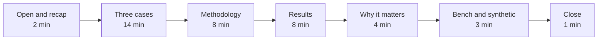


---

## Slide 03 — How to read a case

**Kicker:** Act 1 · Three cases — you are the marker
**Heading:** The answer I ask you for

**Lead:** One book, ten years, four benefit lines. Every answer must state four things. If it does not, the answer scores nothing.

**Code block (answer schema, unchanged):**

```
{ "benefit": "Death", "years": [2018, 2024],
  "pattern": "drift",        // drift | shock | volatility | recovery
  "direction": "increase",
  "magnitude": "+0.15/yr, A/E 0.66 -> 1.31",
  "evidence": ["ae_death_by_year.csv: monotone rise, CI unchanged"],
  "recommended_action": "refer Death frequency to pricing and reserving" }
```

**Note under code:** The scoring is strict. The benefit line, pattern, window, and direction must all agree with the planted truth. One wrong pattern word produces one miss and one false alarm. The scorer ignores duplicates. On a clean book, any finding is a false alarm.
**Graph — how one finding is scored**

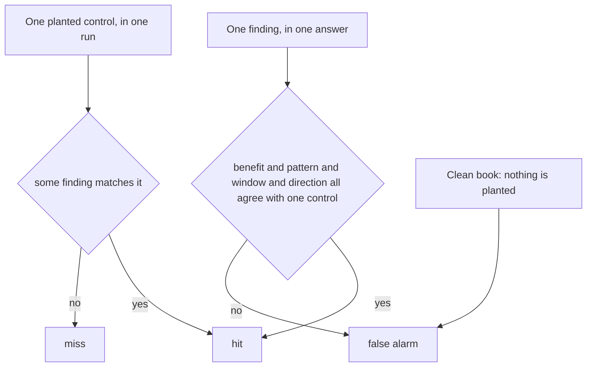

**Graph note:** One wrong element gives one miss and one false alarm. Duplicates are ignored.


**Card 1 — drift:** A sustained year-over-year change over two years or more. The value may revert at the end. It is still a drift.
**Card 2 — shock:** An abrupt change of level with no build-up. The shape is flat-topped or a single year.
**Card 3 — volatility:** More year-to-year scatter. The level does not change. People often call this a spike.
**Card 4 — recovery:** The IP termination rate for one diagnosis changes. The incidence does not change.

**Source line:** contract verified against data/prompts/system_v2_baseline.txt
**Speaker notes:** 2:30–4:00 — Explain the answer contract before the quiz. Without it the reveals make no sense. Stress the four-part agreement. This is how an experience study conclusion must be stated: line, pattern, years, direction. State that a vague answer scores nothing.

---

## Slide 04 — Case 1 — easy

**Kicker:** Act 1 · Case 1 — labelled easy
**Heading:** Book sc-f69eea · what do you report?

**Table A — A/E values by year**

| | 2015 | 2016 | 2017 | 2018 | 2019 | 2020 | 2021 | 2022 | 2023 | 2024 |
|---|---|---|---|---|---|---|---|---|---|---|
| **Death A/E** | 0.626 | 0.701 | 0.637 | 0.660 | 0.784 | 0.983 | 1.063 | 1.113 | 1.261 | 1.307 |
| CI A/E | 1.006 | 1.004 | 0.965 | 1.048 | 1.024 | 1.024 | 0.971 | 1.045 | 1.012 | 1.021 |
| TPD A/E | 0.986 | 1.041 | 1.025 | 1.029 | 1.010 | 0.963 | 1.013 | 1.007 | 1.018 | 0.985 |
| IP A/E | 1.023 | 1.029 | 0.996 | 0.999 | 0.997 | 0.999 | 0.978 | 1.004 | 0.998 | 1.012 |

**Chart:** Death A/E values, 2015 to 2024. Expected = 1.00. The shaded band is the Poisson noise band, ±1/√E. A label asks the audience for the benefit line, pattern word, years, and direction.
**Graph — Death A/E, book sc-f69eea**

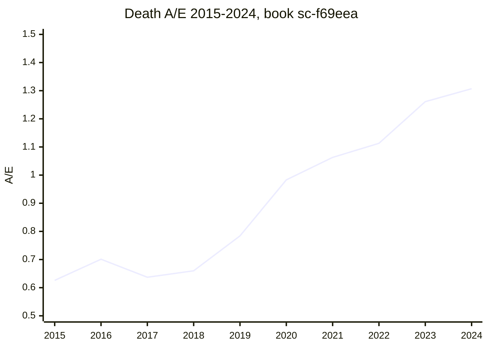

**Graph note:** The planted drift starts in 2018. The level before 2018 is already low. CI, TPD and IP are not changed.


**Note 1:** The other three lines: CI 0.96–1.05, TPD 0.96–1.04, IP 0.98–1.03 over all ten years. Expected Death claims grow from 240 to 826 per year, so the early years are noisier than the late years.
**Question on slide:** Name the finding.

**Reveal — hidden until you press R**
**Reveal card — Planted truth**

| field | value |
|---|---|
| benefit | Death |
| pattern | drift, increase |
| window | 2018–2024 |
| size | planted factor +0.15/yr · observed A/E 0.66 → 1.31 (fitted +0.108/yr) |

**Reveal note:** The generator did not change CI, TPD, or IP. Nothing else is in the file.

**Source line:** data/eval/optimization/sc-f69eea · truth manifest drift_death_up_2018_2024
**Speaker notes:** 4:00–6:00 — Do not rush. Let the audience read the numbers. Ask for a show of hands on which pattern word they would use and where the window starts. The trap in the easy case is small: the drift does not start in 2015. The pre-2018 level is already low, and the window matters.

---

## Slide 05 — Case 1 — what they said

**Kicker:** Act 1 · Case 1 · the answer key says
**Heading:** Everyone sees the easy one. Two configurations still failed it.

**Table A**

| configuration | what the answer said (verbatim) | strict | FP |
|---|---|---|---|
| 3.6, no harness | 3/3 runs: "Death drift, ~+0.065/yr, A/E rises from 0.63 to 1.31" — one finding, nothing invented | 3/3 | 0 |
| **3.8, no harness** | run 1 and run 3: the same finding. run 2: the same finding plus three entries that read "CI — no anomaly. A/E 0.965–1.048, flat around 1.0" … | 3/3 | 3 |
| 3.8 + its harness (one tuning pass) | "~+0.084/yr; total A/E rise from ~0.63 to ~1.31, Δ≈+0.68 over 10 years" — clean | 1/1 | 0 |

**Card 1 — The insight was never the problem:** A one-way rise from 0.66 to 1.31 is obvious. Recall in this family is 100 % for every harnessed configuration.
**Card 2 — Restraint is scored:** Writing that a line is acceptable, as its own finding, is a false alarm. Model 3.8 did this 13 times in the held-out exam alone (23 times across the whole corpus) with no harness. Model 3.6 did it once in none of its runs. The rulebook clause exists because of this case.
**Card 3 — The window is loose on purpose:** All models wrote 2015–2024 and the scorer accepted it. The rule is window overlap, not window equality. A planted 2018 start inside a claimed 2015 start still counts. Treat this as generous, not as an error.

**Source line:** results/xam_v5 · xam_q36 · harness_opt_p7 — scored by score_xam.py v3
**Speaker notes:** 6:00–7:00 — Both models found the drift, as expected. The useful part is the run where 3.8 with no harness wrote the three clean lines as findings ("No anomaly. A/E 0.965-1.048…") and received 3 false alarms. Restraint is a scored behaviour, not politeness. Also point out the window: they wrote 2015-2024 and still received credit, because the rule is window overlap.

---

## Slide 06 — Case 2 — medium

**Kicker:** Act 1 · Case 2 — labelled medium
**Heading:** Book sc-0ce4d6 · CI line, one large number

**Table A — CI line**

| | 2015 | 2016 | 2017 | 2018 | 2019 | 2020 | 2021 | 2022 | 2023 | 2024 |
|---|---|---|---|---|---|---|---|---|---|---|
| A/E | 0.910 | 0.908 | 0.947 | 0.818 | 0.925 | 0.824 | 0.882 | 1.412 | 1.237 | 0.891 |
| actual | 543 | 654 | 793 | 788 | 1015 | 1021 | 1222 | 2186 | 2126 | 1687 |
| expected | 596 | 720 | 837 | 963 | 1097 | 1239 | 1386 | 1548 | 1719 | 1893 |

**Note 1:** Death, TPD, and IP in this book are flat (0.94–1.15 / 0.98–1.04 / 1.00–1.26). This is the whole exhibit.
**Note 2:** The year 2022 is 41 % above expected. The year 2023 is 24 % above expected. Then the value returns. Name the finding.
**Note 3:** The Poisson z for 2022 is +16.2. This is the largest single-year z in the deck so far. Is that evidence, or is it a trap?

**Chart:** CI A/E values, 2015 to 2024, with the Poisson noise band.
**Graph — CI A/E, book sc-0ce4d6**

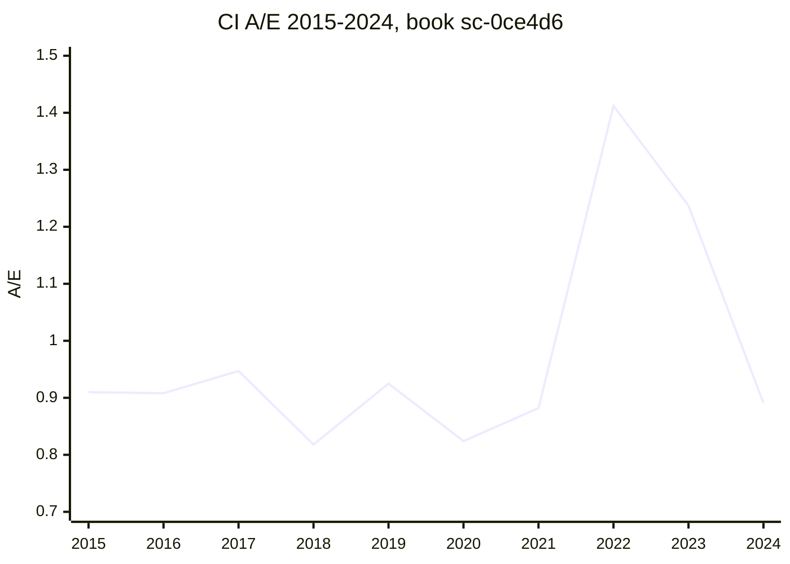

**Graph note:** The scatter is the finding, not the 2022 spike. The planted control is volatility over 2017-2023.


**Reveal — hidden until you press R**
**Reveal card — Planted truth, and it is not what you said**

| field | value |
|---|---|
| benefit | CI |
| pattern | volatility, dispersion |
| window | 2017–2023 |
| size | σ = 0.3 injected on the counts |

**Reveal note:** No shock was planted. The generator multiplied the year-to-year noise. The 2022 spike is amplified sampling scatter. The largest number on the page is not the finding.

**Source line:** data/eval/heldout/sc-0ce4d6 · family = noise_trap · truth trap_noise_drift_lookalike_b
**Speaker notes:** 7:00–9:30 — This case makes actuaries uncomfortable. Let them state "shock 2022-2023" first. Almost everyone does. Then reveal the truth: the planted answer is volatility, which is noise amplification. The 2022 spike is a coin flip that landed high. Ask: how would you know this from the data? That question is the whole talk in miniature.

---

## Slide 07 — Case 2 — what they said

**Kicker:** Act 1 · Case 2 · the answer key says
**Heading:** Same book, three behaviours

**Table A**

| configuration | what it said | hit | FP |
|---|---|---|---|
| **3.6, no harness** | 3/3 runs, same answer, high confidence: "CI shock 2022–2023 — A/E jumps to 1.41 in 2022 and 1.24 in 2023, then reverts to 0.89" — confidence 0.8, 0.9, 0.95 across the three runs | 0/3 | 3 |
| 3.8, no harness | run 1 was correct because it gave two readings: "CI volatility 2015–2024: empirical SD ~0.19 versus ~0.02–0.04 implied" and "CI shock 2022–2023". Runs 2 and 3 removed the volatility entry: "persistent below-baseline A/E" | 1/3 | 5 |
| 3.6 + its harness | "CI volatility, dispersion — empirical SD ~0.24 vs Poisson ~0.03 (×8 overdispersion)" — stated first, 3/3 runs. Two runs still add the shock as a second entry | 3/3 | 2 |
| 3.8 + its harness | states volatility 3/3 and keeps a separate shock entry in every run. The rulebook tells it to record both readings when the evidence cannot separate them | 3/3 | 3 |

**Sub-heading:** The evidence moved the result, not the model
**Body:** Without a harness, the model must create the dispersion test itself. Model 3.6 never did. It read the spike and called it a shock, three times, at confidence 0.9. With a harness, the test is computed before the model is called and is given to the model:

**Code block (published evidence pack text):**

```
YoY sd: empirical 0.2435 vs Poisson 0.0305 -> overdispersion x7.97
       (Poisson null INVALID on this line)
evidence profile: scatter-dominant: the largest single-year move
       exceeds the net level change ... if this scatter is the
       finding, say so for THIS line and give the years
```

**Card 1 — The second reading has a price:** Model 3.8 with a harness scores one hit and one false alarm in every run of this book. It is correct more often and is still less trustworthy. This is the precision and recall problem in one scenario.
**Card 2 — Family score, noise_trap:** The best result across both models and both harnesses is 50 % accuracy. This family is still difficult in 2026.

**Source line:** published pack text from results/harness_final/zero_shot/sc-0ce4d6_prompt.md
**Speaker notes:** 9:30–11:00 — Read the three rows from left to right. 3.6 alone: 0/3, wrong every time, confidence 0.9. 3.6 with harness: 3/3 hits, and it names the overdispersion. 3.8 with harness: the hit in every run, but it also reports the 2022 shock, so it receives a false alarm each time. The rulebook tells it to record both readings when the evidence cannot separate them. The price of the second reading is on the record.

---

## Slide 08 — Case 3 — hard

**Kicker:** Act 1 · Case 3 — labelled hard
**Heading:** Book sc-c9d78b · four findings are planted here

**Table A — A/E values by year**

| | 2015 | 2016 | 2017 | 2018 | 2019 | 2020 | 2021 | 2022 | 2023 | 2024 |
|---|---|---|---|---|---|---|---|---|---|---|
| **Death A/E** | 1.027 | 0.925 | 0.996 | 1.070 | 1.030 | 1.294 | 1.009 | 0.893 | 0.913 | 0.970 |
| **IP A/E** | 0.979 | 1.017 | 1.020 | 1.025 | 1.045 | 1.127 | 0.967 | 0.965 | 0.969 | 0.946 |
| CI A/E (not changed) | 1.006 | 1.004 | 0.965 | 1.048 | 1.024 | 1.024 | 0.971 | 1.045 | 1.012 | 1.021 |
| TPD A/E (not changed) | 0.986 | 1.041 | 1.025 | 1.029 | 1.010 | 0.963 | 1.013 | 1.007 | 1.018 | 0.985 |

**Chart:** Death and IP A/E values, 2015 to 2024, with the Poisson noise band.
**Graph — Death A/E, book sc-c9d78b**

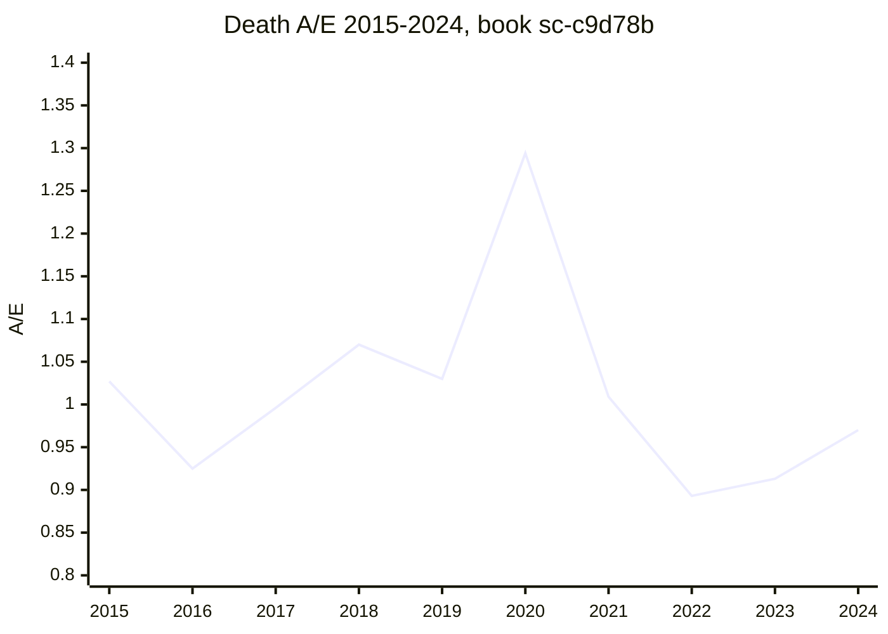

**Graph note:** The 2020 shock is the only part most readers see. The 2016-2019 drift is inside the noise.

**Graph — IP A/E, book sc-c9d78b**

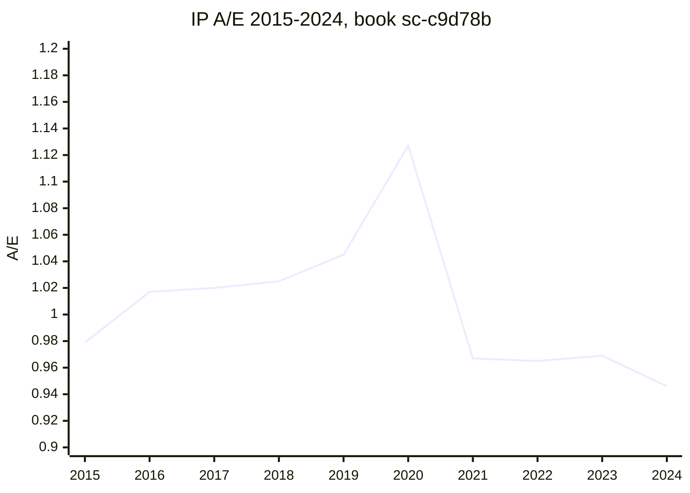

**Graph note:** The IP line carries the same two controls: a drift 2016-2019 and a shock in 2020.


**Note on chart:** Four separate planted findings. Two of them are obvious. Can you name the other two?
**Hint:** Expected Death claims are 240–830 per year, so one year of Death A/E carries a Poisson standard deviation of about ±0.05. CI and TPD are not changed.

**Reveal — hidden until you press R**
**Reveal card — Planted truth, 4 units**

| # | control |
|---|---|
| 1 | Death drift +0.05/yr, 2016–2019 |
| 2 | IP drift +0.03/yr, 2016–2019 |
| 3 | Death shock 2020, factor ×1.3 |
| 4 | IP shock 2020, factor ×1.2 |

**Reveal note:** One coordinated event across two lines: a four-year rise, then a one-year increase. The Death drift fitted from the data gives slope +0.039/yr, SE 0.0195, t = 2.0 on 2 degrees of freedom. It is not detectable. The IP drift at +0.03 against ±0.026 is also not detectable.

**Source line:** data/eval/heldout/sc-c9d78b · family = systemic · truth sys_cascade_drift_shock_2018 · regression fitted by me from the shipped CSV
**Speaker notes:** 11:00–13:30 — Four findings, two lines, three of them not visible. Let the audience find the 2020 Death shock first. Everyone does it. Then ask what else is in the file. This is the slide where the noise arithmetic matters: a drift of 0.05/yr against ±0.045 Poisson noise on four points. I computed t = 2.0 on the four observed points. Neither a person nor a machine can sign that off.

---

## Slide 09 — Case 3 — what they said

**Kicker:** Act 1 · Case 3 · the answer key says
**Heading:** 2 out of 4, in every single run

**Table A**

| configuration | per run | typical answer |
|---|---|---|
| 3.8 + own harness | 2/4 | run 1 names both shocks exactly (z +6.6 / +5.0). Runs 2 and 3 replace the IP shock with an accidental IP drift. Run 3 adds three more findings |
| 3.6 + own harness | 2/4 | run 2 is the cleanest answer in the deck: two entries, both shocks, no extra text, zero false alarms |
| 3.8, no harness | 2/4 | Death shock plus an IP drift that ends in 2020. That entry scores only because the window overlaps. It also adds an invented IP recovery read from a pooled termination A/E of 0.955, and two entries that state "No anomaly" |
| 3.6, no harness | 1.7/4 | runs 1 and 3 are clean: two entries, zero false alarms. Run 2 reports Death 2020 as volatility 2015–2024 instead of a shock, and loses the unit |

**Card 1 — The most useful answer in the corpus:** Model 3.8, own harness, run 3: five findings for four planted units, and three of them are false alarms. The entries read "Death drift 2022–2024, ~+0.038/yr, R² 0.93, a below-baseline level recovering toward 1.0" and "Death volatility 2020–2024, ×3.23 overdispersion".
Every number in those entries is correct. The finding is still wrong. The late rise is the return to the previous level after the 2020 shock. It is not a second event. The arithmetic is correct and the claim is false.

**Sub-heading:** Why 2/4 is the maximum score here

| unit | strict hits in the six harnessed runs |
|---|---|
| Death shock 2020 | 6/6 |
| IP shock 2020 | 2/6 |
| IP drift 2016–19 | 4/6 |
| Death drift 2016–19 | 0/12 |

**Body:** The Death shock is 6.6 Poisson standard deviations and nobody misses it. The IP shock (5.0 sd) is the one that disappears: when the model reports the whole line as one drift, the drift scores and the shock inside it is lost. One event, one entry, one unit short. The IP drift was only ever recovered by accident. The claims that landed pointed at 2015–2020 or 2016–2024 and survived because the scorer asks for window overlap. All six harnessed runs scored exactly 2/4. The Death drift was never recovered in twelve runs.
**Closing line:** Read this as a maximum score, not a failure. Three of the four planted findings could not be recovered from the exhibit. An actuary with the same file would also score 2/4.

**Source line:** per-control verdicts from results/harness_final/scores.json and results/harness_q36_final/scores.json
**Speaker notes:** 13:30–15:00 — Every configuration lands on 2/4. That is the honest maximum, because three findings sit inside the noise. Point at run 3 of 3.8 with the harness: five claims for four truths, and three false alarms. That is the shape of over-claiming: not a lack of intelligence, but too much generosity. Then the key point: the Death drift was never recovered. Claims aimed at 2022-2024 or 2015-2020 miss the planted 2016-2019 window.

---

## Slide 10 — Case 4 — the clean book

**Kicker:** Act 1 · Case 4 — the one with nothing in it
**Heading:** Book sc-12be68 · the answer is "nothing"

**Table A — A/E values by year**

| | 2015 | 2016 | 2017 | 2018 | 2019 | 2020 | 2021 | 2022 | 2023 | 2024 |
|---|---|---|---|---|---|---|---|---|---|---|
| **Death A/E** | 0.944 | 1.163 | 0.966 | 0.973 | 1.010 | 0.999 | 0.980 | 1.015 | 1.019 | 0.990 |
| CI A/E | 1.006 | 1.004 | 0.965 | 1.048 | 1.024 | 1.024 | 0.971 | 1.045 | 1.012 | 1.021 |
| TPD A/E | 0.986 | 1.041 | 1.025 | 1.029 | 1.010 | 0.963 | 1.013 | 1.007 | 1.018 | 0.985 |
| IP A/E | 1.023 | 1.029 | 0.996 | 0.999 | 0.997 | 0.999 | 0.978 | 1.004 | 0.998 | 1.012 |

**Chart:** Death A/E values, 2015 to 2024, with the Poisson noise band.
**Graph — Death A/E, book sc-12be68**

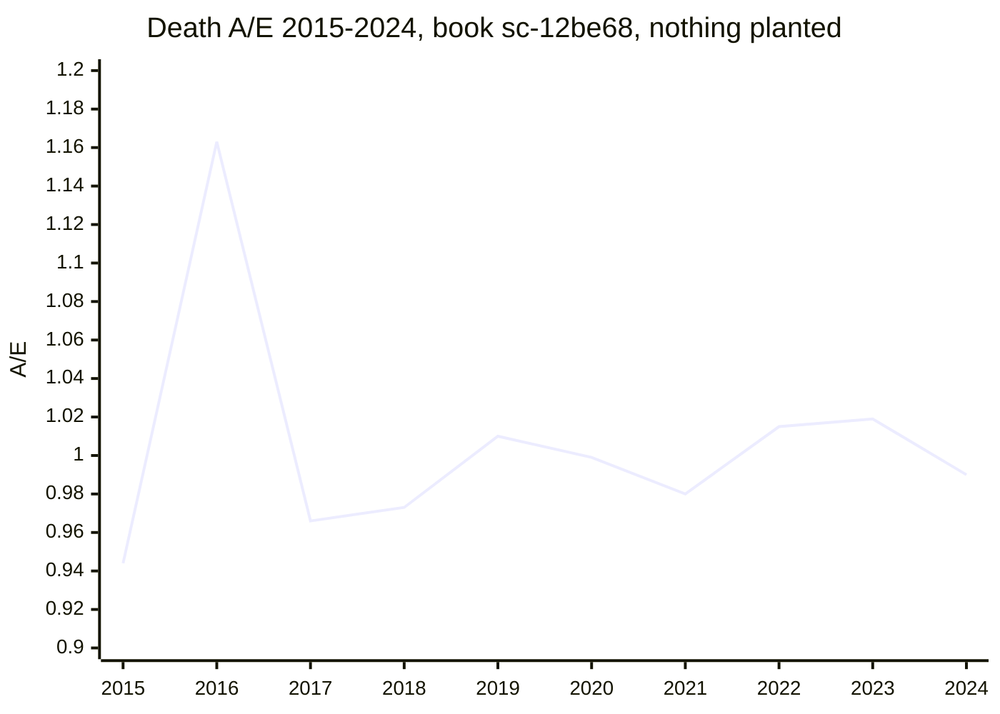

**Graph note:** The 2016 point is a real z of +2.78 and still not a finding. Nothing is planted in this book.


**Question on slide:** Forty line-years. Nothing is planted anywhere. What do you write in the commentary?

**Reveal — hidden until you press R**
**Reveal card 1 — The answer key is empty:** There are zero controls. Any finding at all is a false alarm.
**Reveal card 2 — Model 3.8 reported a finding**
With no harness:

> "Death · shock · 2016 · ~+0.16 A/E; 337 actual vs 290 expected deaths, +47 claims" — confidence 0.65. Model 3.8 reported this in 2 of 3 runs. Model 3.6 reported nothing in all six of its runs.

The arithmetic is correct: z = +2.78. But across 40 line-years, the chance that one cell reaches ±2.8 is about 20 %. Ordinary books produce this. The rulebook clause that fixed it: "a single-year excursion around z 3 is the kind of thing ordinary books produce, so leave it out."

**Source line:** data/eval/heldout/sc-12be68 · family = CLEAN (noop_neutral_controls, bit-identical to baseline)
**Speaker notes:** 15:00–17:00 — This is the most important case for a governance audience. One book in the exam has nothing planted. Model 3.6 reported nothing six times out of six. Model 3.8 without a harness reported a problem in 2 of 3 runs, and the year it chose is a genuine +2.8 z. An ordinary book produces a move of this size several times a decade. With a harness, both models report nothing. Reporting nothing is a capability.

---

## Slide 11 — What the cases taught

**Kicker:** Act 1 · the pattern behind the four cases
**Heading:** Seeing is not the hard part. Deciding what deserves to be written down is.

**Card 1 — Large findings are found:** Shock family: 100 % accuracy and 8 % false-alarm rate for both harnessed models. A 7-sigma year is not missed.
**Card 2 — Small findings are missed:** Drift sits at 67 % for every configuration. In several books the drift is arithmetically undetectable. This is not a failure of the model.
**Card 3 — Almost nothing is invented from nothing:** Under the 3.8 harness, 31 of 69 false alarms had no matching miss at all. These were pure inventions. Under the 3.6 harness: 6 of 50.

**Closing line:** This raises the question an actuary really has: who decided that was a hit? That is the method in Act 2, and it is where agentic coding earns its place.

**Source line:** family rates: held-out split, 23 books × 3 runs, sc-e6ffa4 excluded (see Act 3)
**Speaker notes:** 17:00–17:45 — Bridge slide. Say it plainly: the model sees well. What fails is the judgement about what deserves to be written down. That reframes the next three acts. We measure a system that turns a judgement into a number.

---

## Slide 12 — Act 2 opener

**Kicker:** Act 2 · Methodology
**Heading:** How a judgement becomes a number you are allowed to quote

**Card 1 — 1 · Data:** generated, not collected. The answer key exists and never leaks.
**Card 2 — 2 · Instrument:** evidence pack + rulebook + pinned prompt = the harness.
**Card 3 — 3 · Growth:** a third model edits the harness on recorded failures, one hypothesis at a time.
**Card 4 — 4 · Marking:** strict scorer, two ledgers, frozen gate, one used held-out exam.

**Closing line:** This is where the agentic part lives. It is not a chatbot with a spreadsheet. It is a loop that edits code against a test set it is not allowed to read.

**Source line:** docs/MODEL_AND_HARNESS_EVOLUTION.md §2 · docs/HARNESS_GROWTH.md
**Speaker notes:** 17:45–18:00 — Transition: the method is not administration. It is what makes the sentence "the model is 71 % accurate" defensible. Say that this act is the agentic-coding part they asked for: the loop where a model improved the system around itself.

---

## Slide 13 — The data factory

**Kicker:** Act 2 · Methodology · data
**Heading:** Ground truth you can give to a stranger

**Code block:**

```
git clone Synthetic_Life_Insurance_Data_Generator   # separate public repo
python3 scripts/generate_scenarios.py --scale full  # ~1 h, seed 42, 250 000 policies
```

**Table A — two zones**

| zone | what is in it | who may see it |
|---|---|---|
| data/eval/… | 47 books, opaque ids sc-<6hex>, A/E CSVs + PNGs | the model |
| data/truth/… | manifests, id map, seal.json | the scorer only |

**List**
- The baselines are about 1.0 by construction. A control changes the actual values only, inside a date window. The expected values never change. An A/E change is the planted signal and nothing else.
- The build is deterministic. The same scenario id gives the same bytes. You can reproduce it from commit pin 66a73d0 and seed 42.
- The two splits do not overlap. They differ by benefit line, control type, window, and factor: 23 books for tuning, 24 books untouched until the exam. A test set that is similar to the practice set is not a test set.
- A leak scan gates the build. A byte-level scan runs at build time and again before the first API call. The pack must not contain the pattern words. It once refused to start a run because the word "volatility" was in my own rulebook.

**Sub-heading — The eight families are the eight question types**
**Graph — data lineage and the two zones**

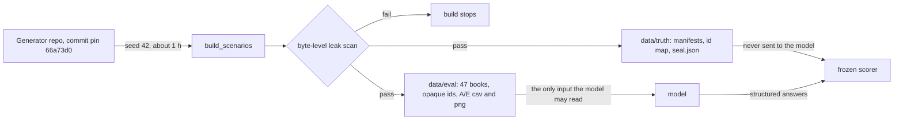


| family | what is planted | held-out books |
|---|---|---|
| drift | a sustained change over several years | 3 |
| shock | an abrupt change of level | 3 |
| volatility | more scatter, flat level | 2 |
| recovery | IP termination rate by diagnosis | 3 |
| systemic | one event, 2 to 4 lines at the same time | 8 |
| mixed | two unrelated events | 2 |
| noise_trap | looks like drift or a spike; the truth is volatility | 2 |
| CLEAN | nothing; any claim is a false alarm | 1 |

**Note:** The trap families are the point. A benchmark of only findable signals measures nothing you do not already know. Four of the eight families are now at the maximum score for both models.

**Source line:** config/scenarios.yaml · scripts/generate_scenarios.py · scripts/leakcheck.py
**Speaker notes:** 18:00–19:15 — Stress the three points an actuary cares about: determinism (same seed, same bytes), the answer key is generated so nobody labelled anything by hand, and the model-facing tree is opaque and leak-scanned. Mention the two repos: the generator is a data tool; this repo is the exam built on it.

---

## Slide 14 — What the model is fed

**Kicker:** Act 2 · Methodology · the question
**Heading:** One turn, one scenario, about 130 numbers

**Code block (the feed):**

```
Scenario: sc-c9d78b
Files available (paths are relative to the scenario folder):
  - artifacts/ae_death_by_year.csv
  - artifacts/ae_death_age_gender.csv     · listed only —
  - artifacts/ae_death_by_year.png        · readable via a
  - death_claims.csv                      · sandboxed call
  - artifacts/summary.json  … 33 paths
summary.json (overall A/E per benefit, claim counts):
  { "Death": {"overall_ae": 1.004, "claims": 5020}, … }
artifacts/ae_death_by_year.csv — yearly (Actual, Expected, AE):
  2015: Actual=246 Expected=240 AE=1.027
  2016: Actual=268 Expected=290 AE=0.925
  2017: Actual=336 Expected=337 AE=0.996
  …
```

**Metric 1:** ~2.7k — prompt tokens with no harness. Four yearly series, ten rows each, plus the file list.
**Metric 2:** ~6.6k — the same exam once the computed evidence pack is added.

**Sub-heading — What is deliberately not in the feed**
- the scenario name. The name sys_cascade_drift_shock_2018 would state the answer.
- the manifest, the id map, and anything under data/truth/.
- the charts. They are listed by path and not shown. This is an exam about numbers, not about images.

**Card — Why this matters to you:** A model given 130 numbers has no excuse for an arithmetic error. You also have no excuse for a conclusion that cannot be traced to a row. Every published run keeps its exact prompt. The file sc-c9d78b_prompt.md is on disk: 20 409 bytes, with a SHA-256.

**Source line:** verbatim from results/harness_final/zero_shot/sc-c9d78b_prompt.md
**Speaker notes:** 19:15–20:15 — The small size of the feed is the surprise: about 130 numbers. Everything else is a path the model may choose to read. Point out that this is a text exam. The PNG files are listed, but the model is not shown them in these campaigns.

---

## Slide 15 — The harness

**Kicker:** Act 2 · Methodology · the instrument
**Heading:** The harness: three parts, one variable

**Card 1 — 1 · Evidence pack (stats_pack.py):** The pack computes deterministic statistics from the same CSVs before the call. It reports the trend gradient and R², the largest step, non-overlapping excursion windows, the onset ratio, the longest run, the 3-year smoothed series, the tail segment, the overdispersion per line, and the swing coordination across lines. It shows evidence, not conclusions. It also states this.
**Card 2 — 2 · Rulebook (HARNESS_RULES · 5 021 chars):** The rulebook gives the pattern words, the output schema, and the rules about what does not count. Mild overdispersion is normal. A z of 3 in one year is normal. A small age cell is not evidence. A finding that describes something you do not claim must not exist.
**Card 3 — 3 · Pinned system prompt + up to 4 sandboxed calls:** The prompt lives in a file, so you can version it without changing the runner. The model may run `python -I -c` against the scenario folder: 10 s limit, 4 000 chars of output.

**Card 4 — the 2 × 2 design; nothing else changes**

| | no harness | own harness |
|---|---|---|
| Qwen3.6-27B | 59.5 % accuracy · 40.0 % FP | 65.8 % · 38.7 % |
| Qwen3.8-27B | 64.0 % accuracy · 65.7 % FP | 71.2 % · 41.9 % |

**Note:** Same weights, same endpoint, same sampler (temp 1.0, top_p 0.95, top_k 20), one generation at a time on one llama.cpp slot, three runs each. Both subjects share the 27 B architecture. Every difference between them is behaviour, not capacity.

**Card 5 — The sandbox is advisory, not enforced. We state this clearly:** `run_sandboxed_python()` has a timeout, an output cap, and a set working directory. There is no rlimit. There is no network block. There is no filesystem jail. A direct probe showed that model-written code could read the truth manifests. All 97 tool calls in the campaigns stayed inside artifacts/. The model chose to do that. If you rebuild this, put a real jail in place before you run anything untrusted.
**Graph — what the harness is and how one run is called**

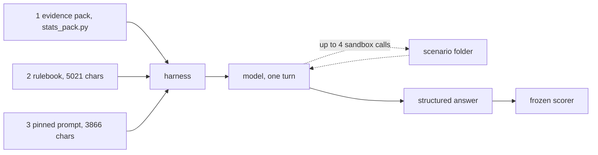


**Source line:** scripts/stats_pack.py · HARNESS_RULES in scripts/run_zero_shot.py · README §2
**Speaker notes:** 20:15–21:15 — Define "harness" once, plainly: deterministic evidence + rules + prompt, around the model. Stress that nothing differs between the arms except the harness: same model weights, endpoint, sampler, one turn. This 2 × 2 is what everything else rests on.

---

## Slide 16 — The loop (agentic)

**Kicker:** Act 2 · Methodology · the agentic part
**Heading:** A model grew the harness, under rules

**Loop step 1 — Run:** Run the frozen harness over the 23 optimization books. Keep the corpus: prompt, answer, tool log, and the scorer difference for each unit.
**Loop step 2 — Read the failures:** For each failed unit, state why it failed. Use the record: the stored prompt, the answer, and the difference. Do not use opinion.
**Loop step 3 — One hypothesis, one edit:** Add one block to stats_pack.py, one rule, or one new pinned prompt. Never two at the same time.
**Loop step 4 — Validate offline first:** Regenerate all 23 packs and compare them. Confirm that the CLEAN book and every solved book are unchanged. Run the leak preflight. Zero API calls.
**Loop step 5 — Re-run that one book, 3 times:** A single-book run costs about 10–40 min. A full 23-book pass costs 2 h (3.6) to 7 h (3.8).
**Loop step 6 — Keep or revert:** Compare the result with the pre-registered bar. A failed edit is reverted, not adjusted. Three edits failed this way in the 3.6 campaign.
**Loop step 7 — Store the bytes:** Copy the code and the prompt into harness_snapshot/ with hashes before the next run. Then any number can be traced to the instrument that produced it.
**Loop step 8 — Never:** Never tune against the held-out split. Never let a held-out result influence an edit. The held-out split is used once and then it is used up.

**Body:** Who wrote the code? A third model drove the loop: DeepSeek V4.1 Flash. It is deliberately not one of the two subjects, so no subject tuned the exam it later sat. It produced 7 harness versions for 3.8 (v1.0 to v1.6e) from 307 per-scenario diary entries. 268 of those entries involved reviewing or editing the harness. It produced two kept edits for 3.6 from the same base.
**Graph — the growth loop, eight steps**

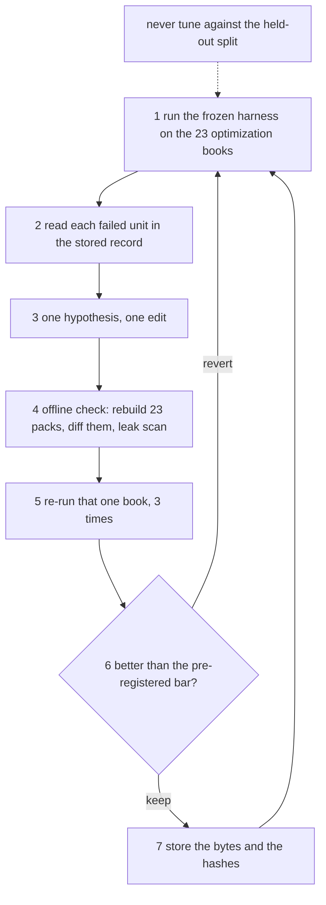


**Card — The two limits I will not hide:** A person chose which failures to chase. The model proposed and applied the changes, but it did not set the agenda. And the stored bytes prove which harness produced which numbers. They do not prove who typed each line. The runbooks describe that work. The description is not the evidence.

**Source line:** docs/MODEL_AND_HARNESS_EVOLUTION.md §2.5 · docs/HARNESS_GROWTH.md Parts 2 and 3
**Speaker notes:** 21:15–23:15 — This is the centre of the agentic-coding story. Say it in one line: I did not write the harness. A third model edited it, against recorded failures, under rules that stop it from cheating. Stress one hypothesis per pass. That is a limit the compute forced, and it is also what makes the result auditable. Note the honesty: the loop did not set the agenda; a person chose which failures to chase.

---

## Slide 17 — Edits that survived

**Kicker:** Act 2 · Methodology · what the loop actually shipped
**Heading:** Seven versions, four kept edits, three reverts

**Table A**

| the edit | what it was for | result, measured |
|---|---|---|
| smoothed-window labelling | The 3-year moving average labelled its windows on one side only, so a smoothed shape looked like it stopped two years before the data did | a drift was reported as a shock · kept — part of the +4-unit gain at pass 2 |
| onset caution | It names a competing sustained-run reading when the onset ratio was measured against too narrow a window | one systemic book · kept with a guard · 0/3 → 3/3 |
| coordination guard | The caution above broke a different book | kept · 4/4 → 11/12, pack identical elsewhere |
| the TAIL block | The final three years' gradient, fit, and level against the years before, because a late rise was cancelled in the whole-window fit | two late drifts the pack made invisible · net 0: it recovered 2 units and cost 2 (the model then read a shock line as a drift). False alarms went 0.52 → 0.91 per answer, because my own wording invited a second entry |
| rule 3c sharpened | "One entry per affected line; naming the largest line and mentioning the others in prose counts as finding only the largest" | The model's prose said "coordinated with IP" and then produced one line · +1 unit · a rule-following failure, not a knowledge failure |
| GIVE-BACK scoping · clause-3b efficiency rewrite · TAIL rebound guard | three further ideas | reverted — no change, no effect, or worse (3/6 vs 4/6) |

**Card 1 — The rejected fix:** After the freeze gate passed, we found better wording ("extend the same finding's window into the tail" instead of "add a second finding"). We did not apply it. Editing the instrument right after it passes the bar it just certified is how a tuning set becomes overfitted.
**Card 2 — The idea that failed four times:** A dispersion floor low enough to catch the planted-unsteadiness books fires on 28 lines. Only 4 of those are correct, and 16 of the false ones are shocks the model currently gets right 15 times out of 15. Trading a real skill for a weaker measure is not an improvement. The ×6 rule stayed.

**Source line:** docs/HARNESS_GROWTH.md Parts 3–4 · report §3.3 · the loop fixed more in 25 minutes than four full optimisation passes did
**Speaker notes:** 23:15–24:15 — These are concrete code edits. This is what agentic coding looks like at file level. Best story: the tail block. We added it because the model's prose said the right thing and the schema lost it. It recovered two units, cost two others, and produced +9 false alarms that the write-up owns. Mention the rejected fix: they found better wording after passing the gate and refused to apply it, because that is how you overfit a tuning set.

---

## Slide 18 — Marking discipline

**Kicker:** Act 2 · Methodology · the marking
**Heading:** Two ledgers, and a gate fixed in advance

**Table A — the metrics**

| metric | formula | the question it answers |
|---|---|---|
| accuracy (strict recall) | hits ÷ units | did it find what was there? |
| FP/claim | false alarms ÷ claims | when it spoke, how often was it wrong? |
| precision | hits ÷ claims = 1 − FP/claim | how far can you trust it out loud? |

**Card — Worked example: 3.8 with its own harness**

```
units 111   strict hits 79   false alarms 57   claims 79 + 57 = 136
accuracy  = 79 ÷ 111 = 71.2 %
FP/claim  = 57 ÷ 136 = 41.9 %
precision = 79 ÷ 136 = 58.1 %
```

**Note:** A unit is one planted control in one run. A control that covers the whole book becomes one unit per benefit line. Accuracy and FP/claim never add to 100 %. The denominators are different. In the units ledger, accuracy + miss = 100 %. In the findings ledger, precision + FP/claim = 100 %. Reporting only one of the two hides half of what happens.
**Graph — the two ledgers**

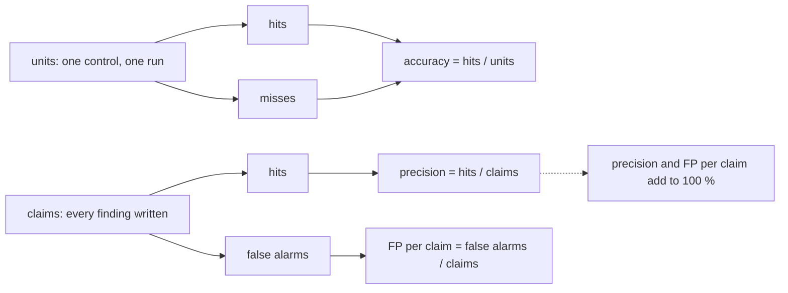


**Card — The freeze gate, agreed before any tuning**
- strict recall ≥ 80 %
- false alarms ≤ 1.0 per answer
- zero anomalies claimed on the CLEAN book
- zero unparseable answers, zero errored runs
- no regression on the two drift groups against the zero-shot reference. This clause stops a harness from buying recall by giving up a real skill.

**Note:** The exit status is 0 or 1. Nothing in the gate calls the LLM. A person later chose to raise the 3-pass limit. That was legitimate, but only because the held-out books were still unread.

**Card — The most transferable number in the whole project**

| model | tuning split | held-out exam | gap |
|---|---|---|---|
| Qwen3.8 | 97.7 % | 69.1 % | −28.6 |
| Qwen3.6 | 95.5 % | 63.4 % | −32.1 |

**Note:** A sign-off based on the tuned numbers would have been wrong by about 30 points, for both models. An optimisation split is a ranking device. It is not a forecast.

**Source line:** scripts/score_xam.py v3 · scripts/harness_gate.py · report §2.7, §2.8, §3.6
**Speaker notes:** 24:15–26:00 — Two points: the two-ledger arithmetic (do not mix recall and false alarms; the denominators differ) and the freeze gate (a pre-registered stopping rule, so "done" is not a matter of taste). State the optimism gap clearly: tuning said 97.7 %, the exam said 69.1 %. That 30-point gap is the most transferable result in this project for a risk audience.

---

## Slide 19 — Act 3 opener + headline

**Kicker:** Act 3 · The results
**Heading:** One exam, six configurations, 69 answers each

**Table A**

| configuration | accuracy | FP/claim | precision |
|---|---|---|---|
| **Qwen3.8 + its own harness** | 71.2 % | 41.9 % | 58.1 % |
| **Qwen3.6 + its own harness** | 65.8 % | 38.7 % | 61.3 % |
| Qwen3.8 + the 3.6 harness | 70.3 % | 43.1 % | 56.9 % |
| Qwen3.6 + the 3.8 harness | 64.9 % | 43.3 % | 56.7 % |
| Qwen3.8, no harness | 64.0 % | 65.7 % | 34.3 % |
| Qwen3.6, no harness | 59.5 % | 40.0 % | 60.0 % |

**Note:** Held-out split, 23 common books × 3 runs. sc-e6ffa4 is excluded from every row so the rows are like-for-like. It is reported separately, on its own slide. Green marks the best value in a column.
**Graph — accuracy, six configurations**

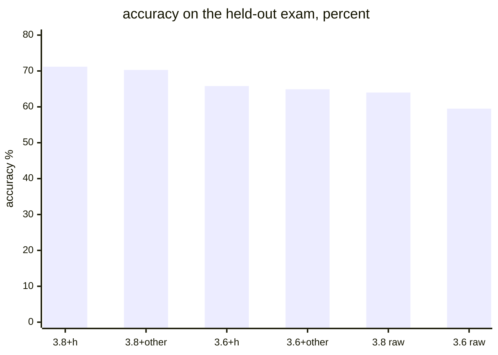

**Graph note:** h = the model's own tuned harness. other = the other model's harness. raw = no harness.

**Graph — precision, six configurations**

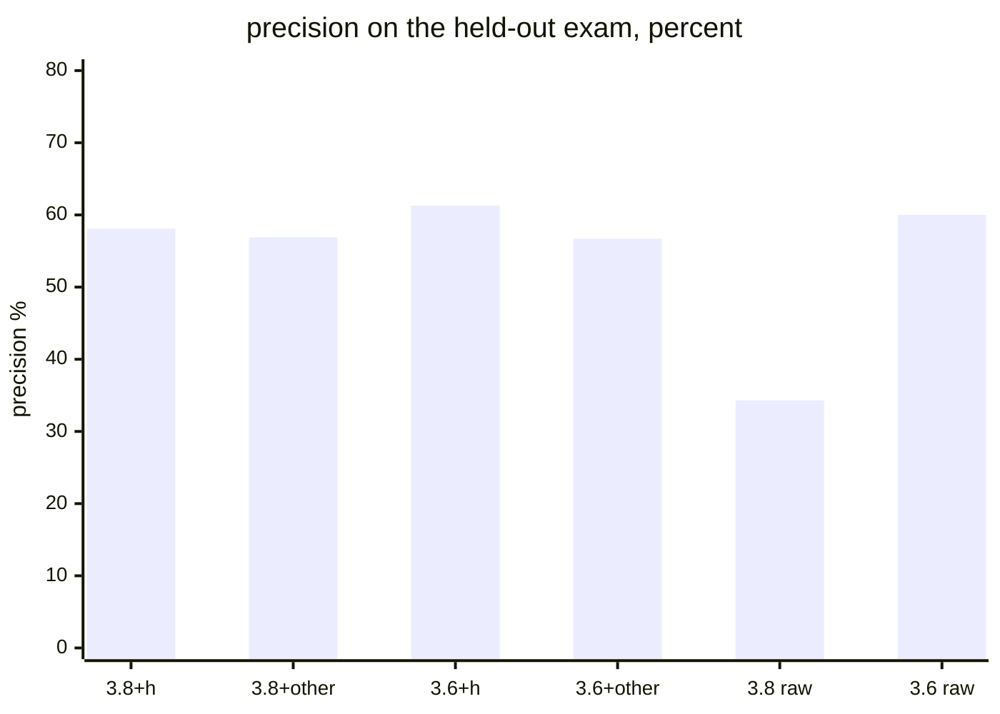

**Graph note:** The order changes. Accuracy ranks 3.8 first. Precision ranks 3.6 first.


**Metric 1:** +5.4 — points of accuracy for 3.8: the recall lead
**Metric 2:** +3.2 — points of precision for 3.6: the trust lead

**Card 1 — The ranking reverses on the second metric:** Accuracy alone puts 3.8 first. Precision puts 3.6 first. Neither result is wrong: 3.8 finds more and invents more; 3.6 finds less and states less that is untrue. Which model is "better" depends on your cost of a miss against your cost of a false alarm. It is not a question about models.
**Card 2 — The row nobody expects:** Model 3.8 with no harness (64.0 % accuracy) almost matches model 3.6 with a full harness (65.8 %), at 34.3 % precision instead of 61.3 %. The recall is comparable. The trustworthiness is very different. Recall alone would have called these two configurations the same model.

**Source line:** results/harness_final · harness_q36_final · harness_q36_final_v16e · xam_v5 · xam_q36 — recomputed from the run records, matches published
**Speaker notes:** 26:00–27:15 — Six rows, the same 23 books, three runs each. Every row is like-for-like. State the result twice: accuracy ranks 3.8 first; precision reverses that. Then note the fourth row: 3.8 with no harness is almost as accurate as 3.6 with a full harness, at 34 % precision instead of 61 %. Same recall, very different trustworthiness.

---

## Slide 20 — What the harness is worth

**Kicker:** Act 3 · Results · the instrument
**Heading:** The same wrapper is worth different things to different models

**Sub-heading:** Harness, subtracted: before → after

| measure | before → after |
|---|---|
| 3.8 precision | 34.3 → 58.1 |
| 3.8 accuracy | 64.0 → 71.2 |
| 3.6 accuracy | 59.5 → 65.8 |
| 3.6 precision | 60.0 → 61.3 |

**Body:** The problem with 3.8 was that it stated too much, and the harness fixed that: +23.8 points of precision. Model 3.6 never had that problem, so the same rules bought +1.3 precision and gave recall instead. Two harnesses, one starting point, different results, because the two models lacked different things.
**Graph — accuracy before and after the harness**

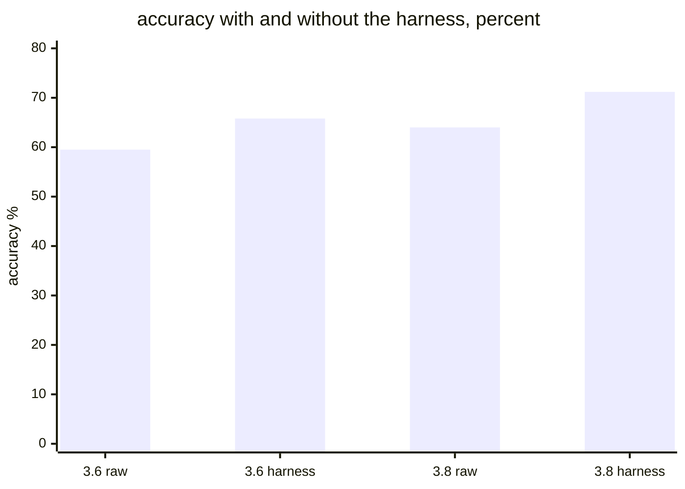

**Graph — precision before and after the harness**

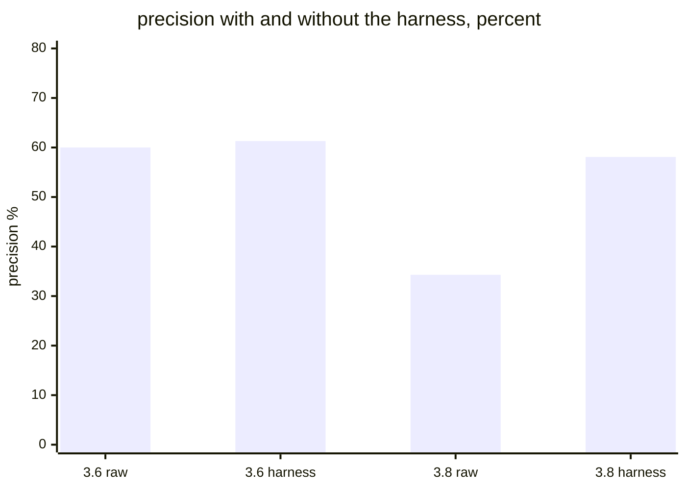

**Graph note:** The same rules buy +1.3 points to 3.6 and +23.8 points to 3.8.


**Card 1 — A harness does not transfer:** Every cross-loaded cell scored below its tuned cell. The one clean controlled comparison gives 3.6 the exact bytes of the 3.8 harness. It is worth 5.7 accuracy points to 3.8 and nothing on precision:

| configuration | result |
|---|---|
| 3.6 on the 3.8 instrument | 78/123 = 63.4 % · 55.3 % precision |
| 3.8 on the 3.8 instrument | 85/123 = 69.1 % · 55.2 % precision |

**Card 2 — We published a claim and then withdrew it:** Early, on 9 scenarios: "+8.3 points of harness transfer." On 23 scenarios the same comparison gave −1. The claim is gone from the repo, and the withdrawal is recorded in the runbook. A harness is part of a model deployment. It is not infrastructure you qualify once.

**Source line:** report §3.2, §3.5 · identical instrument = stats_pack 16e53e0ef0b097ab, run_zero_shot a4b967de975625f9, 3866-char prompt
**Speaker notes:** 27:15–28:15 — Three sentences. The same wrapper is worth 24 points of precision to one model and 6 points of accuracy to the other. It does not transfer. A new model version receives an unproven harness, not a working one. The withdrawn claim is the credibility moment. State it plainly: we published +8.3, the sample grew, the result became −1, and we withdrew it.

---

## Slide 21 — Where the difficulty lives

**Kicker:** Act 3 · Results · by question type
**Heading:** Four of the eight families are at the maximum score. Two carry the signal.

**Table A** — each cell shows two values: accuracy / FP per claim, in percent

| family | 3.6 raw | 3.8 raw | 3.6 harnessed | 3.8 harnessed |
|---|---|---|---|---|
| systemic | 41 / 52 | 54 / 66 | 44 / 51 | 56 / 51 |
| shock | 75 / 25 | 67 / 72 | 100 / 8 | 100 / 8 |
| drift | 67 / 25 | 67 / 70 | 67 / 33 | 67 / 40 |
| mixed | 93 / 7 | 80 / 48 | 87 / 24 | 87 / 28 |
| recovery | 100 / 0 | 100 / 55 | 100 / 0 | 100 / 0 |
| volatility | 100 / 0 | 100 / 60 | 100 / 57 | 100 / 60 |
| noise_trap | 0 / 100 | 17 / 92 | 50 / 62 | 50 / 70 |
| CLEAN | silent | reported a false finding | silent | silent |

**List**
**Graph — accuracy by family, 3.6 with its harness**

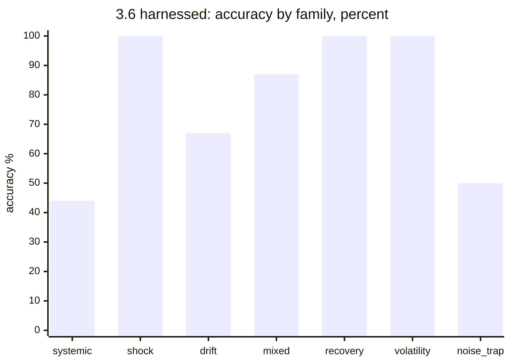

**Graph — accuracy by family, 3.8 with its harness**

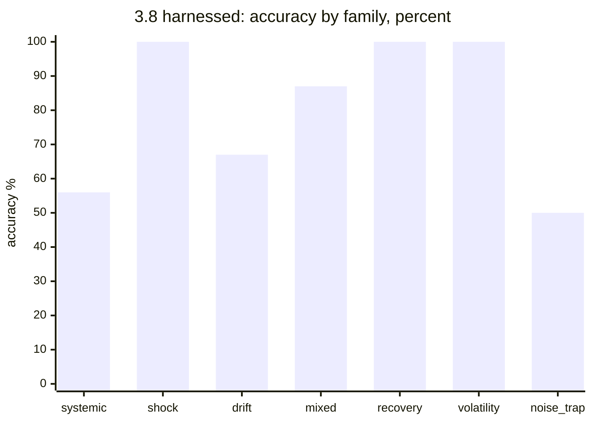

**Graph note:** The two models are equal in five families. The difference sits in systemic.


- drift, recovery, and volatility reach 100 % recall for every harnessed configuration. They can no longer separate two models. They are now regression tests, not exams.
- systemic is where the models really differ (44 % against 56 %): several lines move for one shared cause. This is the closest case in the set to a real experience-study finding, and it is also the hardest.
- noise_trap is the maximum for everyone: 50 % at best. Without a harness, 3.6 scored 0 % accuracy with 100 % false alarms. It reported anomalies and was wrong about every one.
- Honesty on the CLEAN book is a behaviour, not a score. Both models report nothing once the harness says "a z of 3 in one year is normal". Without a harness, 3.8 could not do this.

**Card — The design lesson for your own evaluation:** If every question can be answered, accuracy measures how often the model answers at all. The power to separate two models in this benchmark sits almost entirely in the traps, the clean books, and the multi-line events. A first draft of any evaluation never includes these.

**Source line:** report §3.1 · held-out split, three runs per family
**Speaker notes:** 28:15–29:15 — The family table is the most useful slide for anyone who designs their own evaluation: four of eight families are at the maximum, so they cannot separate models. Almost all the signal is in systemic and noise_trap. If your benchmark has no traps and no clean books, it measures how often the model answers.

---

## Slide 22 — The actual words

**Kicker:** Act 3 · Results · the actual words that score
**Heading:** Same book, same confidence, opposite results

**Lead:** Both answers come from sc-c9d78b, the four-finding book from Act 1. The planted truth is two 2020 shocks on Death and IP.

**Card 1 — Scores: 3.6, own harness, run 2 — 2/4, zero false alarms**

```
{ "benefit": "Death", "years": [2020,2020],
  "pattern": "shock", "direction": "increase",
  "magnitude": "spike to A/E 1.29 (~+0.27 over baseline),
                Poisson z ~ 6.6", "confidence": 0.95 }
{ "benefit": "IP",   "years": [2020,2020],
  "pattern": "shock", "direction": "increase",
  "magnitude": "spike to A/E 1.13 (~+0.13 over baseline),
                Poisson z ~ 5.0", "confidence": 0.9 }
```

**Note:** Two entries. Both are planted controls. Nothing else is written. Benefit line, pattern word, years, and direction all agree, so both count. The whole answer is four fields.

**Card 2 — Costs you twice: 3.8, own harness, run 3 — 2/4, three false alarms**

```
{ "benefit": "Death", "years": [2022,2024], "pattern": "drift",
  "direction": "increase", "confidence": 0.5,
  "magnitude": "~+0.038/yr (0.893 -> 0.913 -> 0.970, R2 0.93);
     a below-baseline level (window mean ~-0.125 vs pre-2022)
     recovering toward 1.0" }
{ "benefit": "Death", "years": [2020,2024], "pattern": "volatility",
  "direction": "dispersion", "confidence": 0.4,
  "magnitude": "YoY sd 0.154 vs Poisson 0.048 (x3.23 overdispersion);
     onset ratio 2.07 (max 1yr move 0.285 > net excursion)" }
```

**Note:** Every number in those two entries is correct. The drift and the overdispersion are real. But nothing was planted there. So each entry is a miss on the unit it failed to describe, and a false alarm in the findings ledger. One wrong judgement produces two entries on the scoreboard.

**Card 3 — What the pattern words buy:** The four pattern words are the whole contract. A finding that gives the right line and the right years with the wrong pattern word scores nothing. Pattern agreement is exact. The vocabulary is not decoration. It is the score.
**Card 4 — What is deliberately not marked:** `recommended_action` is required in every answer and recorded in every corpus, and it is never scored. Grading free-text professional advice is a separate unsolved problem. Pretending to grade it would make the whole number less trustworthy, not more.

**Source line:** verbatim from results/harness_q36_final/zero_shot/sc-c9d78b_run02.json · harness_final/…run03.json
**Speaker notes:** 29:15–30:45 — This is the slide with the literal words that score. Compare the two answers. Both come from the same book and both are confident. The winning answer is short and uses the pattern words. The losing answer is longer, quotes correct arithmetic, and is still wrong. Also point out the honesty channel in the schema: evidence and recommended_action are recorded but not scored, because grading free-text advice is unsolved.

---

## Slide 23 — What it falsely claimed

**Kicker:** Act 3 · Results · what it invented
**Heading:** The false-alarm group changed shape, not just size

**Table A**

| claimed pattern of the false alarm | 3.8 no harness | 3.8 harnessed | 3.6 harnessed |
|---|---|---|---|
| "other" — often the words "no anomaly" | 51 | 1 | 0 |
| shock | 50 | 42 | 31 |
| drift | 12 | 13 | 11 |
| volatility | 9 | 13 | 8 |
| recovery — invented from a pooled age/diagnosis cell | 23 | 0 | 0 |

**Note:** This is the shape of the false-alarm group, recomputed for this talk from the published run records. It counts every finding that a strict match did not claim, on the 24-book held-out split, 3 runs each. My recount: 145 → 69 for 3.8, and 50 for 3.6. The official scorer discards a few duplicates.
**Graph — false alarms by claimed pattern, 3.8 with no harness**

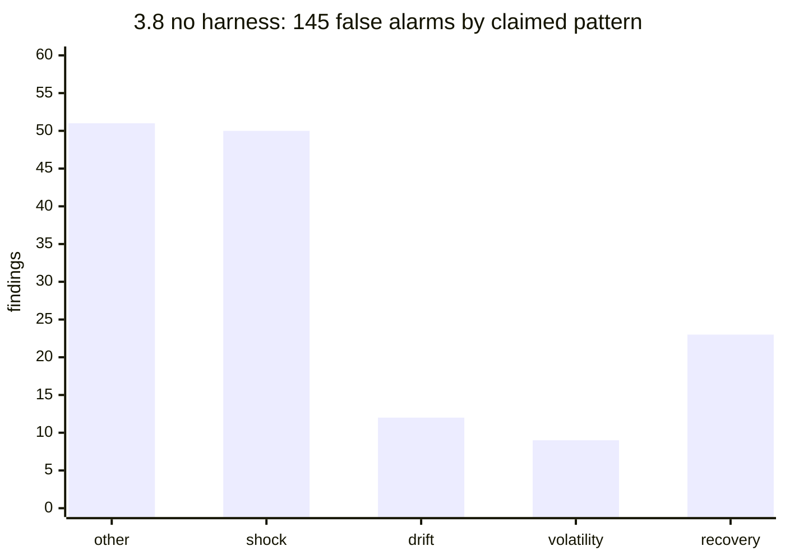

**Graph — false alarms by claimed pattern, 3.8 with its harness**

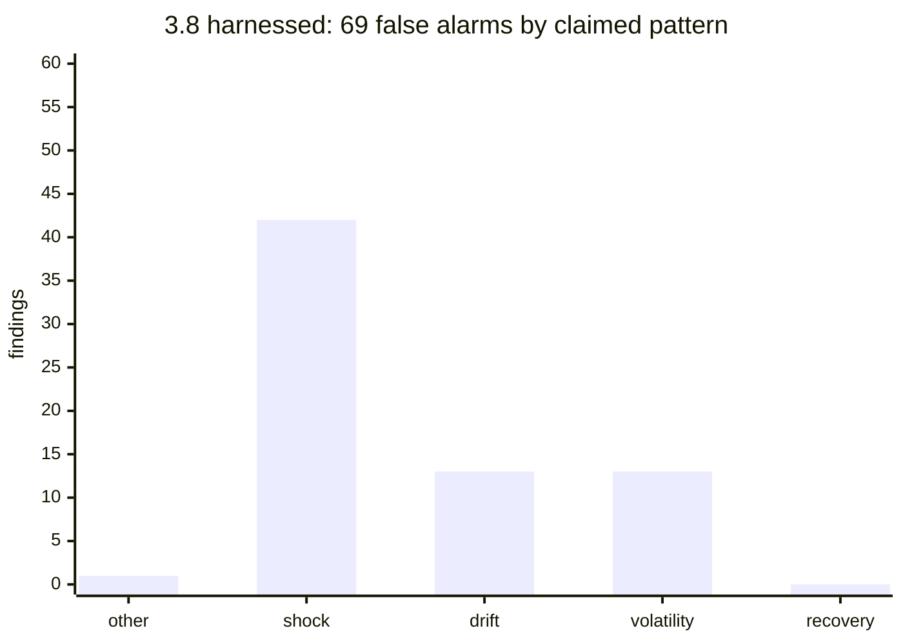

**Graph — false alarms by claimed pattern, 3.6 with its harness**

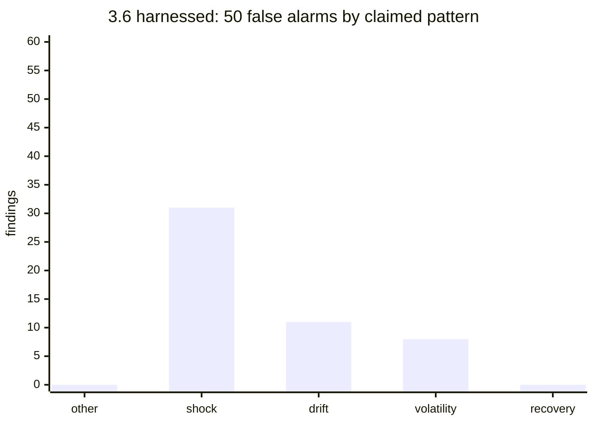

**Graph note:** Two rules removed the other group and the recovery group completely. What is left is mislabelling.


**Card 1 — Two rules removed two failure modes:** The rule "listing an observation you are not claiming is scored as a false alarm" takes the entries whose magnitude reads "No anomaly" from 13 to 0. The rule "small cells are not evidence" takes the invented recoveries read from a pooled 0.955 termination A/E from 23 to 0. Two rules removed two complete failure modes. What is left is honest disagreement about which pattern it was.

**Card 2 — Over-claim and mislabel are different, and the fixes are opposite**

```
false alarms = mislabels (a control was also missed)
             + over-claims (nothing was missed — it is invented)

3.8 own harness : 69 false alarms, 38 misses  ->  +31 inventions
3.6 own harness : 50 false alarms, 44 misses  ->  +6 inventions
```

**Body:** Model 3.8 produces 157 claims for 123 planted units. That is 28 % more findings than there is anything to find. Model 3.6 produces 129 claims for 123 units, and its errors are almost entirely mislabels: right line, wrong word.
**Card 3 — We tested the wrong fix:** Over-claiming needs rules about restraint. Mislabelling needs work on the vocabulary. Making 3.6 report less did nothing; its numbers did not move. The edits that worked for 3.6 taught it the pattern words. Same instrument, opposite treatment, both measured.

**Source line:** report §3.7 · pattern shares recounted for this talk from the published run records
**Speaker notes:** 30:45–32:00 — Two failure shapes need two different fixes. This is the key point for a governance audience. Over-claiming needs discipline; mislabelling needs vocabulary. We tested the wrong treatment and confirmed that it fails. State my recount note aloud: these pattern shares are my own recount of unmatched findings, so they include a few duplicates that the official scorer discards.

---

## Slide 24 — Cost beside the score

**Kicker:** Act 3 · Results · the other axis
**Heading:** What one answer costs, printed next to what it bought

**Table A — one 72-call held-out exam**

| configuration | tokens | wall clock | accuracy | precision |
|---|---|---|---|---|
| 3.6 + own harness | 0.89 M | 5.9 h | 65.8 % | 61.3 % |
| 3.8 + own harness | 1.95 M | 21.9 h | 71.2 % | 58.1 % |

**Note:** Every API call actually made in those two corpora, retries included, on one llama.cpp slot at about 17.5 tokens/s, on equal 72-call exams.
**Graph — cost of one 72-call held-out exam**

```mermaid
xychart-beta
    title "tokens per exam, millions"
    x-axis ["3.6 with harness", "3.8 with harness"]
    y-axis "million tokens" 0 --> 2.5
    bar [0.89, 1.95]
```

**Graph — wall clock of one 72-call held-out exam**

```mermaid
xychart-beta
    title "wall clock per exam, hours"
    x-axis ["3.6 with harness", "3.8 with harness"]
    y-axis "hours" 0 --> 25
    bar [5.9, 21.9]
```

**Graph — median answer, tokens and minutes**

```mermaid
xychart-beta
    title "median completion tokens per answer"
    x-axis ["3.6 harness, 4.8 min", "3.8 harness, 13.5 min", "3.8 raw, 16.4 min"]
    y-axis "completion tokens" 0 --> 20000
    bar [5719, 13763, 16227]
```


**Card — The result:** Model 3.6 reaches 93 % of the accuracy of 3.8 with a quarter of the wall clock (5.9 h against 21.9 h) and 46 % of the tokens, with better precision. After you adjust for cost, the "weaker" model is better on three of four measures.

**Card — Median per answer**

| configuration | wall clock | reasoning | completion tokens |
|---|---|---|---|
| 3.6 held-out | 4.8 min | 15.6 k chars | 5 719 |
| 3.8 held-out | 13.5 min | 33.9 k chars | 13 763 |
| 3.8 no harness | 16.4 min | 43.1 k chars | 16 227 |

**Card — Tool use is a behaviour, not a switch**

| model | share of runs that used python in the sandbox |
|---|---|
| 3.8 | about 24 % |
| 3.6 | 0 of 144 |

**Body:** Model 3.6 never used the sandbox, after two separate attempts to make it do so, including wording that made the tool mandatory. It correctly judges that the pack already contains the arithmetic. The tool loop is dormant. That difference is exactly what a harness must be tuned around: the only hard failure in this study was a malformed tool request, which 3.6 cannot produce.

**Source line:** report §3.8, §3.9 · corpora totals include every retry actually made
**Speaker notes:** 32:00–32:45 — Cost changes the ranking, so it never goes in a footnote. 3.6 reaches 93 % of the accuracy of 3.8 for about a third of the time and tokens, with better precision. Then the tool difference: one model used the sandbox in a quarter of the runs, and the other never once in 144 runs. That is a behaviour, not a defect, and it is exactly what a harness must be tuned around.

---

## Slide 25 — The failure we published

**Kicker:** Act 3 · Results · results that give no advantage to anyone
**Heading:** One failure kept on the record, and two misses that were not the model's fault

**Card 1 — sc-e6ffa4: never answered, never deleted**
All four lines are volatile. Six or more attempts, one that ran 2 h 25 min, and zero usable answers. This is what was on disk instead of an answer:

```
{"tool": "python", "code": "import csv\nfrom collections import…
parse error: Invalid \escape: line 1 column 2108 (char 2107)
```

Model-written code inside a bad JSON escape. The tool never ran. The validator also rejected the answer. A misleading TruncatedStream label made it retry forever. Three conditions had to occur together, and the harness was one of them: the volatility guidance block that describes this book exactly was absent from that prompt.

| treatment | result | meaning |
|---|---|---|
| excluded (23 books) | 70.3 % | how did it do on what it attempted? |
| counted as 0/12 (24 books) | 63.4 % | the honest worst case |

**Note:** This costs 6.9 accuracy points and leaves FP/claim unchanged, because an aborted run produces no claims at all. The conclusions are unaffected: every gap in Act 3 is bigger than ±7. The parser defect was deliberately not patched. A documented failure stays auditable; a patched one becomes a silent gap. This book must always be reported as failed.

**Card 2 — Part of the miss rate is the exam's fault**
**sc-d72b95** — a Death drift planted at +0.05/yr over 2021–2024. Fitted from the file: slope +0.0253/yr, SE 0.0251, t = 1.01, where four points need |t| > 4.30 at 2 degrees of freedom. The 95 % interval [−0.083, +0.133] contains zero and the planted value. To resolve +0.025/yr at 80 % power needs about nine years of data at this noise level, not four.
Model 3.6 finds all three identifiable controls in that book. It is at the maximum on everything the data support, and the scoreboard still counts the fourth as a miss.
**sc-f520e5** — the planted truth is volatility (variance ratio F = 17.1 against a critical value of 5.41). But the same Death line also moves 0.95 → 1.34 → 0.80: a mean of 1.102 inside the window against 0.943 outside. The model's alternative "drift" reading is supportable from the data. Edits that pushed it toward the truth made the score worse, because they asked it to ignore a real feature.

**Card 3 — The line to remember:** Before you reject the model, check whether the exhibit could have supported the answer you wanted. Identifiability comes before accuracy, in a benchmark and in a real experience study.

**Source line:** report §3.10, §3.11
**Speaker notes:** 32:45–34:00 — Two governance stories. Left: the aborted scenario. The honest handling is to report it as failed, give both bounds, and show that the conclusions do not move, and to leave the parser unpatched so it stays auditable. Right: two units that are not the model's fault. The planted drift in sc-d72b95 is about half the size that four annual observations can resolve, so 3.6 is at the maximum on everything identifiable. A part of every benchmark score is the fault of the benchmark.

---

## Slide 26 — Act 4 · the pair

**Kicker:** Act 4 · Why this matters
**Heading:** You do not govern a model. You govern the pair.

**Lead:** Before a company approves an LLM for experience work, four questions must be answered. One convincing demo answers none of them.

**Card 1 — 1 · How good is it?:** How much of what is really in the data does it find, on books nobody tuned on?
**Card 2 — 2 · What does it miss, and what does it invent?:** These are two different failures. They have different costs and different fixes. They cannot be averaged into one score.
**Card 3 — 3 · What does one answer cost?:** Time and tokens, printed next to the result they bought, never in an appendix.
**Card 4 — 4 · Is the pipeline around it right?:** And on what evidence would you say the wrapper is still fit for purpose?

**Card 5 — Why the pair, and not the model:** Models 3.6 and 3.8 share one 27 B architecture: parameter count, weight size, compute graph, the same serving slot, and the same sampler. Every difference between them is behaviour: how quickly it states a conclusion, how much it checks before it speaks, and whether it uses a tool at all.
So when a vendor releases a new version, the thing that changes is exactly the thing your harness was compensating for. Behaviour changes when a model is retrained, even when its architecture does not change.

**Card 6 — The sentence to refuse:** "We upgraded the model." That is a notice, not an assessment. A new version receives an unproven harness, not a working one. In this study the tuned harness was worth +23.8 precision points to one version and +1.3 to the next.

**Source line:** the four questions are report §1.2 · the pair argument is report §1.5
**Speaker notes:** 34:00–35:15 — The governance core: you deploy a model and the deterministic thing wrapped around it. Two facts force this: behaviour changed between 3.6 and 3.8 with no architecture change, and the harness was worth different things to each. Use model-change-control language deliberately. This audience works in it.

---

## Slide 27 — What this changes Monday

**Kicker:** Act 4 · Why this matters · operating model
**Heading:** 58 % precision is not a verdict on the model. It is a design constraint.

**Table A**

| if you let it… | then at 58 % precision | and |
|---|---|---|
| write the commentary | 2 of every 5 escalated findings are wrong | not usable |
| **sort the review queue** | it surfaces the 71 % of real movements it sees; a person confirms in minutes instead of screening 40 line-years | this is the one |
| rank by its own confidence | confidences were 0.4–0.95 and did not follow correctness closely enough to depend on | not measured here |

**Card 1 — Priced the way you already price things:** A miss is a deterioration nobody looks at. It is the error that ends up in a reserve. A false alarm is a quarter of an analyst's morning and some credibility for the person who repeats it. Your ratio between those two is the model choice: 3.8 (finds more) if a miss dominates, 3.6 (invents less) if a false alarm dominates. That is an actuarial judgement, not a technology judgement.

**Card 2 — The workflow the numbers support**
1. The harness computes the evidence pack overnight. It is deterministic, uses no model, and costs nothing.
2. The model returns structured findings against a schema. At 3.8 one answer takes about 13.5 min, so this is a batch job, not a chat window.
3. Every finding carries the file and the rows it used, so a person checks the claim, not the reasoning.
4. The reviewer's decision is logged. That log is next year's regression test.

**Note:** Note what is not automated. The pattern judgement stays with the model only because we could verify it here. Where there is no answer key, this is a drafting aid, and nothing more.

**Card 3 — Why the contract matters more than the model:** Four fields, four allowed pattern words, and one rule about what must not appear. That contract is what made this measurable at all. It is the part you can copy into your own stack this quarter without buying anything.

**Source line:** precision figures from the held-out exam · latency medians from the run records
**Speaker notes:** 35:15–36:15 — Make it concrete: 58 % precision is not "bad". It sets one operating model: triage, not decision. Ask the room to price a miss against a false alarm in their own work. That ratio is the whole calibration. Note that 13.5 min per answer makes this an overnight batch tool, not a chat tool.

---

## Slide 28 — Governance checklist

**Kicker:** Act 4 · Why this matters · the control list
**Heading:** The same five controls you already run, restated for a model and its pipeline

**Table A**

| control you already operate | what it means here | what this repo can give an auditor |
|---|---|---|
| Independent validation | The validator is not the builder, and the harness was not tuned by the model that sat the exam | A third model drove the loop; both subjects were scored by one frozen scorer |
| Version change control | A model version and a prompt/stat-pack version together are the unit of change | harness_snapshot/ with SHA-256 per corpus; pinned prompt files |
| Input data integrity | Every model-facing file is hashed; the answer key is provably out of reach | dataset.json hashes, seal.json, byte-level leak scan at build and before run 1 |
| Performance monitoring | Two ledgers, on unseen books, three runs, cost next to the score | Per-run records: prompt, answer, tool log, scorer difference, tokens, wall clock |
| Documented limitations | Failures and undecidable tests are published, not removed | The aborted book, the withdrawn transfer claim, the two unidentifiable units, the reverted edits |

**Card — The question to take back to your next model-risk committee:** "When the model under our pipeline changes, what tells us the pipeline is still right? Who is responsible for asking?" If the answer is "the vendor's blog post", you have an unmonitored dependency inside a regulated process.

**Source line:** mapped to the guarantees in README "Locked guarantees" and BENCHMARK_IMPLEMENTATION_GUIDE §2
**Speaker notes:** 36:15–37:00 — Fast slide; it is the one people photograph. Each line is a control they already operate for cat models and IFRS 17 models, restated for an LLM plus its pipeline. Invite pushback: "what would convince you the wrapper is still fit for purpose" is the question worth taking back.

---

## Slide 29 — What is honest to claim

**Kicker:** Act 4 · Why this matters · the limits
**Heading:** What is honest to claim from this, and what is not

**Card 1 — Two subjects, one serving stack:** "The harness must be re-derived per model" is a real result at a real cost to replicate. But it is two models, both from the Qwen 27 B family, on one llama.cpp slot. It is not a general theory of harness portability. Two more subjects on a different stack would change what I am willing to say in public.
**Card 2 — Synthetic, by construction:** Real books have mix changes, system changes, reinsurance effects, and cohort effects that a planted control does not reproduce. The skill measured here is "is this gap signal". That is the same action as real work, on data whose difficulty I controlled and whose realism I did not.
**Card 3 — A hit here is not good judgement:** These patterns are planted, so a hit means recovering a known signal. A real experience study is a judgement with no answer key: is this deterioration worth a pricing review? This benchmark cannot measure that, however many scenarios I add.
**Card 4 — This exam is used up, and that is by design:** The 24 held-out books are published with their answers, so they can never be an unseen test for anything that reads this repo. A new exam means generating new books with new controls. Benchmarks become out of date: four families are already at the maximum score.

**Closing line:** The point I would repeat in any board paper: a tuning-split score is a ranking device, not a forecast. It overstated real performance by about 30 points here, for both models.

**Source line:** README "Limitations & Assumptions" · report §3.6
**Speaker notes:** 37:00–37:45 — Do not skip this. It gives credibility to everything before it. State five limits plainly: two subjects; synthetic; no answer key in real work; the exam is used up; and a benchmark number is a ranking device, not a forecast. Say which ones I would fix first: more subjects, and a fresh held-out set.

---

## Slide 30 — Act 5 · what a bench buys

**Kicker:** Act 5 · What a benchmark is for
**Heading:** A benchmark is not a leaderboard. It is a test fixture.

**Card 1 — 1 · An answer key that cannot be argued with:** The truth is generated, never collected by hand. Nobody's judgement is inside the labels, so a disagreement is about the model, not about who made the labels.
**Card 2 — 2 · Comparability across time and vendors:** The same 123 units, the same scorer, the same books, for every configuration ever run. "Is the new model better for us?" becomes arithmetic instead of opinion.
**Card 3 — 3 · Regression detection on your own pipeline:** Every harness edit here was validated by regenerating all 23 evidence packs and comparing them. That is a unit test for a prompt, which most teams have never built.
**Card 4 — 4 · Difficulty you can set:** Undetectable drifts, lookalike traps, clean books, and coordinated multi-line events, made on demand at a chosen distance from the noise level.
**Card 5 — 5 · Cost and quality on the same slide:** Tokens and wall clock are recorded per run, so you can price the tool per experience study instead of describing it as "cheap".

**Card 6 — The one property nothing else gives you:** With a fixture you can answer "would anything have noticed?"
The 30-point optimism gap, the withdrawn transfer claim, the rule that removed the 13 "no anomaly" entries, and the sc-e6ffa4 failure cannot be found in a demo. They are visible only because the same exam was run again under a changed instrument, and the difference was arithmetic.

**Card 7 — What the fixture cost**
- A standard-library-only stack, Python 3.11 or newer. The scorer, pack, gate, and leak scan all run offline with no API key.
- A full 23-book pass takes about 2 h (3.6) to about 7 h (3.8) on one consumer slot.
- Every published number is reproducible from the clone: about 135 MB, largest file 0.41 MB.
- The expensive part was never compute. It was the discipline to keep the exam clean.

**Source line:** docs/EXPERIMENT_INDEX.md §7 · replication commands in README Quick Start
**Speaker notes:** 37:45–38:45 — Reframe: a benchmark is not a leaderboard. It is a test fixture for a pipeline. List the five things it buys, each with the concrete example from this project. Stress "comparable across time and vendors". No one-off demo can give you that.

---

## Slide 31 — What synthetic data buys

**Kicker:** Act 5 · Synthetic data
**Heading:** The advantage is not volume or privacy. It is a knowable truth.

**Table A**

| what synthetic data lets you do | impossible with real data | what it measured here |
|---|---|---|
| plant a signal below the noise level | you never know whether it was missed or absent | found the 2 unidentifiable units, then reclassified them as exam defects, not model failures |
| plant a lookalike: volatility that reads as a spike | a false alarm cannot be disproved — was anything really there? | noise_trap: 0 % accuracy at 100 % false alarms for one configuration without a harness |
| plant nothing at all | "the model was right to report nothing" cannot be verified | CLEAN book: the only test of restraint I know how to build |
| move the noise level on purpose | the noise is whatever your portfolio happens to be | ±0.045 Poisson sd against a +0.05/yr drift: identifiability, measured |
| run the same book again forever | portfolios change; your test set becomes out of date | seed 42 plus commit pin: identical packs, so a difference is caused by the harness alone |
| make a new exam in one hour | a fresh unseen set of real books takes a year to collect | the answer to a used-up held-out split: new controls, new books, same scorer |

**Card 1 — And the practical benefits**
- No policyholder data: publishable, shippable, and testable in CI.
- A benchmark you can make public is one a stranger can disprove.
- Both models receive the same bytes, so "they saw the same exam" is provable.

**Card 2 — The debt you owe back:** Synthetic difficulty is not real difficulty. A generator that cannot express mix change, system changes, or reinsurance will teach you a clean version of a messy job. Every number I have shown you is measured on data whose hardness I chose.

**Source line:** generator: Synthetic_Life_Insurance_Data_Generator · baseline A/E ≈ 1.0 by construction; controls change the actual values only
**Speaker notes:** 38:45–39:45 — The centre: the advantage of synthetic data is not volume or privacy. It is that the truth is knowable. Walk the columns of the table. You cannot do these things with real portfolios. Plant an undetectable signal and see it missed. Plant a false pattern and see it believed. Plant nothing and see whether it reports something. Set the noise level and measure identifiability. Then state the realism debt.

---

## Slide 32 — Build your own

**Kicker:** Act 5 · Copy this
**Heading:** Six moves to build one for your own work

**Card 1 — 1 · Pick a task with a planted truth:** Choose work where you can make the answer: A/E anomalies, lapse distortions, reserving outliers, wrongly scaled exposures, or a policy-coding error in a cohort. If nobody can say what the right answer is, it cannot be benchmarked yet.
**Card 2 — 2 · Two zones, and a leak scan:** Model-facing files get opaque ids. The answer key lives elsewhere and is hashed. Scan the question for answer-bearing words automatically, before any call. It will find your own mistakes before it finds the model's.
**Card 3 — 3 · Families, and a trap set:** Easy cases reach the maximum score within one model version. Plan for lookalikes and at least one case where nothing is wrong. Otherwise your accuracy number measures how often the model answers.
**Card 4 — 4 · A contract before a prompt:** A small schema, closed word lists, strict matching, and one explicit rule that an unclaimed observation is a false alarm. A badly formed answer is a miss. This is what makes marking mechanical.
**Card 5 — 5 · Two ledgers, three runs, cost logged:** Report recall and FP/claim, never blended. Use three runs. One run cannot separate a consistent failure from an unlucky one. Several results here reversed when the sample grew from 9 books to 23.
**Card 6 — 6 · Fix the gate before you tune:** Write the stopping rule first, tune on a split you will never report, run the held-out exam once, and keep a byte snapshot of the instrument behind every number.

**Card 7 — Where this project goes next, and where yours can start:** New families for the places where this action repeats: lapse and persistency, expense A/E, morbidity, and reserve-adequacy changes. Each is a new scenario family and a new section of the evidence pack. It is not a new benchmark, not a new scorer, and not a new governance argument. The skill being tested was never "reads A/E tables". It is deciding whether a gap between actual and expected is a signal.

**Source line:** docs/dataset-usage.md · adding a scenario is one registry entry plus a regenerate
**Speaker notes:** 39:45–40:45 — Close the loop: this method transfers, and here is the recipe in six moves with the traps already marked. Land two points. Traps and clean books are not optional. The cost is the discipline, not the compute. Offer to share the checklist afterwards.

---

## Slide 33 — Five things to remember

**Kicker:** Close
**Heading:** Five things to remember

**Card 1 — 1 · Agentic coding is only real when it is measured:** A loop that edits code against a test it cannot read, keeps or reverts on evidence, and stores the bytes behind every number. That is the version worth building, and the only version anyone will allow you to deploy.
**Card 2 — 2 · The model found a lot and invented a lot:** It found 71 % of what was planted, at 58 % precision, with 31 pure inventions and one false claim about a book that had nothing in it. Good detection; it needs a rulebook about what deserves to be written down.
**Card 3 — 3 · The wrapper is part of the system:** It was worth +24 points of precision to one model and +6 points of recall to another, and it did not transfer either way. Measure the pair again after every model change.
**Card 4 — 4 — Two failures, two fixes:** Misses and false alarms have different denominators, different costs, and different fixes. Which model is better is an actuarial decision about the price of those two errors. It is never a technology decision.
**Card 5 — 5 · The gift of synthetic data is a knowable truth:** That is what makes measurement possible at all. The price is the realism debt. Plant the traps, plant the empty book, and publish the failures.

**Source line:** one file, no dependencies: charts drawn from the shipped CSVs, every number recomputed from the published run records
**Speaker notes:** 40:45–41:30 — Slow down. Read each line. Do not add detail; the room has received a lot. Then say: "the evidence is in the repo, ask me anything." Leave this slide on screen for the questions.

---

## Slide 34 — Sources & questions

**Kicker:** Where the evidence lives
**Heading:** Sources, and the questions I hope you ask

**Table A — where to look**

| if you want | path |
|---|---|
| the four questions and the whole argument | docs/MODEL_AND_HARNESS_EVOLUTION.md |
| every corpus, table, and replication command | docs/EXPERIMENT_INDEX.md |
| the harness, version by version, with the reverts | docs/HARNESS_GROWTH.md |
| one scenario, exactly as the model saw it | results/harness_final/zero_shot/sc-c9d78b_prompt.md |
| the scorer, the pack, the freeze gate | scripts/score_xam.py · stats_pack.py · harness_gate.py |
| the data generator (separate public repo) | Synthetic_Life_Insurance_Data_Generator |

**Card 1 — Questions worth asking**
- How did you stop the tuning split from leaking into the reported number?
- What is the smallest drift your own books can detect? Find that out before you blame the analyst, or the model.
- What did a false alarm cost you last quarter, and what did a missed deterioration cost?
- If your vendor released a new model version next month, what would tell you the pipeline still works?
- Why three runs and not one? The noise at temperature 1.0 was about ±3 units of 44. One run would have let me believe anything.

**Card 2 — The one-line version of today:** I built an exam so that "the model is good at experience studies" became a sentence with a denominator. It is a triage tool with a rulebook. It is worth about 24 points of trustworthiness on one model version and nothing on the next. You can audit every number of that.

**Source line:** thank you · slides are one HTML file · numbers recomputed against the published corpora on the day of this talk
**Speaker notes:** 41:30 onward — Q&A. Keep this slide on screen. Answers I hold ready. One: the 30-point gap between the tuning split and the held-out split. Two: the identifiability audit method. Fit the slope and compare it with the smallest detectable slope. Three: why three runs. The spread at temperature 1.0 was ±3 units of 44, so one run would have let me fool myself. Four: why the sandbox is advisory only, and what a real jail needs: rlimits or a container, --network none, and a read-only mount. Five: what I would do first. More subjects, a fresh held-out split, and the lapse family.| family | 3.6 raw | 3.8 raw | 3.6 harnessed | 3.8 harnessed |
|---|---|---|---|---|
| systemic | 41 / 52 | 54 / 66 | 44 / 51 | 56 / 51 |
| shock | 75 / 25 | 67 / 72 | 100 / 8 | 100 / 8 |
| drift | 67 / 25 | 67 / 70 | 67 / 33 | 67 / 40 |
| mixed | 93 / 7 | 80 / 48 | 87 / 24 | 87 / 28 |
| recovery | 100 / 0 | 100 / 55 | 100 / 0 | 100 / 0 |
| volatility | 100 / 0 | 100 / 60 | 100 / 57 | 100 / 60 |
| noise_trap | 0 / 100 | 17 / 92 | 50 / 62 | 50 / 70 |
| CLEAN | silent | reported a false finding | silent | silent |

**Note:** The trap families are the point. A benchmark of only findable signals measures nothing you do not already know. Four of the eight families are now at the maximum score for both models.

**Source line:** config/scenarios.yaml · scripts/generate_scenarios.py · scripts/leakcheck.py
**Speaker notes:** 18:00–19:15 — Stress the three points an actuary cares about: determinism (same seed, same bytes), the answer key is generated so nobody labelled anything by hand, and the model-facing tree is opaque and leak-scanned. Mention the two repos: the generator is a data tool; this repo is the exam built on it.

---

